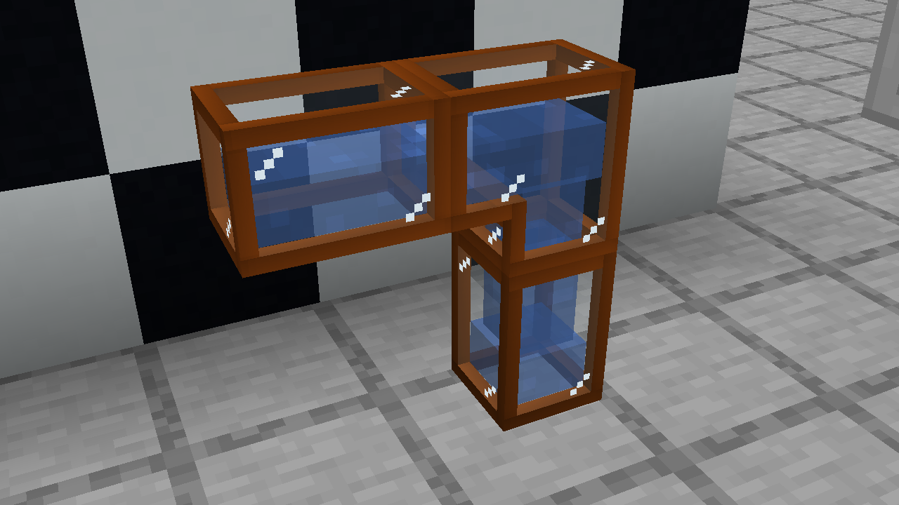
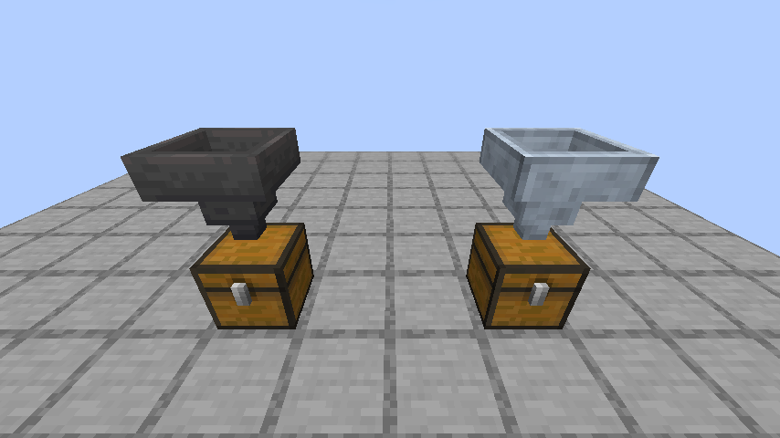
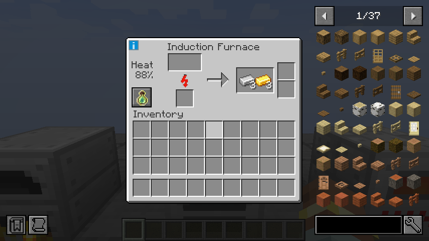
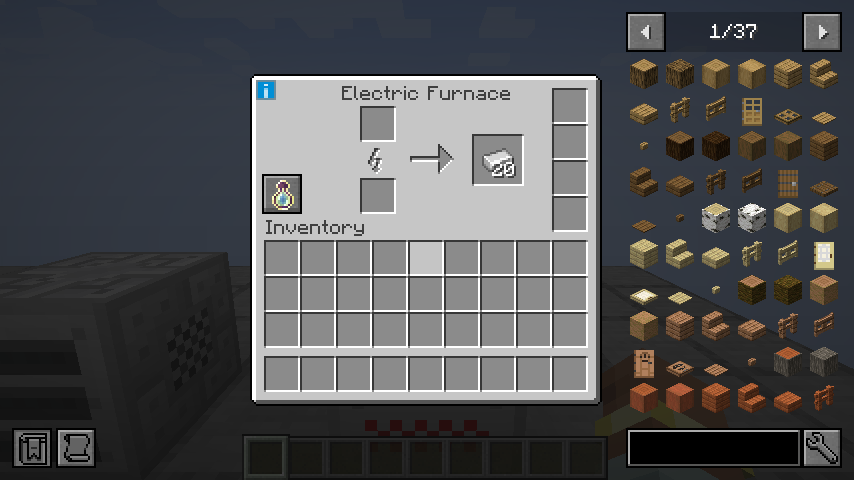

# IndustrialCraft 2: Refactored — Igoryok95 fork

IndustrialCraft 2 for **Minecraft 1.21.1 NeoForge**, with Russian localization, client-language chat messages, safe machine-input inspection,
and experience rewards for processed ore in iron, electric and induction furnaces.


## Version 21.1.80 — Interrupted machine sounds

Removing a canner's container during filling now cancels both pending and already
started operating sounds. The shared machine sound lifecycle also cancels late
buffered playback and stale start-to-loop callbacks. Block removal stops owned
sources. Standard machines recheck output space and fluid containers while working,
and the Induction Furnace restores its active sound after a power interruption.
See [the fixes and validation](docs/machine-sounds-21.1.80.md).

## Version 21.1.79 — Fluid-pipe frame and item fixes

Pipe elbows retain the complete metal corner, and adjacent frame faces share
matching edge vertices. Opaque frames render separately from translucent glazing.
Glass highlights draw only their three reflection pixels, removing the dark
rectangular background left by the former decal.

Bronze and steel pipe items now keep their metal frame in the inventory and in
the player's hand. All eight variants use opaque item tints with their original
material colors. Glass tint, 32px highlight density, recipes and fluid behavior
are preserved. See [details and in-game screenshots](docs/fluid-pipe-visuals-21.1.79.md).



## Version 21.1.78 — Readable fluid-pipe glass

Bronze and steel pipe windows keep a consistent texture scale on straight sections
and elbows. Subtle glazing and small vanilla highlights make the glass visible
without stretching a square border across each window. The highlights retain
their 32px density in all four pipe sizes. Pipe IDs, recipes, contents and transfer
rates are unchanged from 21.1.77.

See [details, validation and in-game screenshots](docs/glass-fluid-pipes-21.1.78.md).


## Version 21.1.77 — Reactor chamber readings in Jade

Pointing Jade at any of a reactor's six attached chambers now displays the central
reactor's heat, maximum heat, nominal EU output and operating state. A standalone
chamber adds no reactor readings. The lookup uses the live adjacent reactor, so a
removed or replaced reactor cannot leave stale telemetry behind. See
[details and validation](docs/reactor-chamber-jade-21.1.77.md).

## Version 21.1.76 — Glass fluid pipes

Bronze and steel fluid pipes have a thin metal frame and glass windows in all four
sizes. Disjoint shell faces remove the camera-dependent stripes caused by overlapping
pipe sections. The visible fluid uses its real texture, tint and fill level;
directional scrolling follows measured transfer and stops when the fluid is stationary.

Each recipe now includes **one clear glass pane**, keeping its existing metal cost
and output count. Pipe IDs, saved contents, capacity, throughput and pump-cover
behavior are preserved. A passive pipe needs a pump cover facing the source, or an
active fluid ejector on that source. See [pipe behavior and validation](docs/glass-fluid-pipes-21.1.76.md).

## Version 21.1.75 — Warm-up display spacing

The Induction Furnace keeps a clear gap between its full `100.00%` heat value,
input slots and energy indicator. Its processing column is repositioned without
changing the font, precision, inventory or machine behavior. See
[GUI validation](docs/warmup-spacing-21.1.75.md). Addons **1.4.5** applies the
corresponding spacing fix to all eight Advanced Machines.

## Version 21.1.74 — JEI and Jade

Optional **Jade** support displays server-owned EU buffers, energy tiers, measured
network flow, storage output, processing progress, machine heat and reactor readings.
Colored gauges use readable labels and exact grouped energy values. Native fluids
and inventories continue to use Jade's own capability displays.

**JEI** resolves actual recipe inputs and player inventory slots instead of assuming
that every dynamic menu has the same layout. This fixes the repeated transfer errors
and stutter in Addons machines. Service capsules, batteries, upgrades and outputs
are excluded from recipe inputs. All three Metal Former modes, both solid-canning
machines and native furnace ingredient transfer are covered; electric furnaces do
not require the decorative fuel shown in JEI's vanilla recipe layout.

The Induction Furnace and Addons Advanced Machines display warm-up percentages to
two decimal places. Install **IC2R Addons 1.4.4** alongside this core for the complete
addon JEI/Jade update. JEI, Jade and Addons remain optional.

See [integration details and validation](docs/jei-jade-21.1.74.md).

## Version 21.1.73 — Energy storage and charging fixes

BatBox, CESU, MFE, MFSU and all four chargepads respect their real EU capacity.
Network receivers return unaccepted energy, and the grid updates remaining demand
after each transfer. Existing overfilled storage saves are normalized when loaded.
Redstone fuel waits until its whole EU portion fits instead of overfilling the buffer.

Electric-item charge updates no longer mutate the menu's previous item snapshots.
The final BatPack charge now updates from 59,900 to **60,000 EU** without moving the item.
Capacities, transfer rates and recipes are unchanged. See [audit and validation](docs/energy-storage-21.1.73.md).

## Steel Hopper (21.1.72)

The **Steel Hopper** transfers one item every **2 ticks** between containers,
up to **10 items/s**, compared with a vanilla hopper's 2.5 items/s.
It uses the vanilla hopper shape, five-slot menu, redstone locking and comparator
behavior, with native **32x32** steel textures, a flat vanilla-style item icon and a yellow item name.
Craft one from **five steel plates and one vanilla hopper**. No EU or addon is required.

See [recipe, behavior and validation](docs/steel-hopper-21.1.71.md).



## Version 21.1.70

Version 21.1.70 restores missing **IC2 Experimental** features:
beer/rum brewing, basic solar helmet and static boots, bronze/steel fluid pipes and
pump covers, dynamite and remote control, radioactive containment, iodine tablets,
MFSU upgrades, a reusable fluid cell and the Compact Item Buffer. Six professions use original Classic skins
with Experimental trades and naturally generated village workshops. IC2R works independently; Addons can extend their trades.

Optional Create/Mekanism compatibility reuses existing intermediates, adds zinc/osmium processing and
retains collectible smelting XP in all three native furnaces. Storage menus keep
the charge gauge and show exact EU in its tooltip. The Russian machine name is
consistently **Компрессор**. A client volume slider controls IC2R sounds; hoppers
balance the Induction Furnace inputs. Local torch buttons keep the Induction Furnace,
Thermal Centrifuge and Blast Furnace warm without powering nearby hoppers. Native
capacities and ore generation are unchanged. New workshops use the existing village structure pools.

Validation: **23 JUnit tests** and **479 standalone GameTests** pass locally and in
[GitHub CI](https://github.com/Igoryok95/IC2R/actions/runs/40213359843).

See [feature details and villager comparison](docs/experimental-restoration-21.1.70.md)
and [preserved fixes](docs/maintenance-21.1.70.md). The 21.1.69 fixes below are retained.

## This fork

Version **21.1.69** builds on upstream **21.1.66** and includes:

- A guard against empty processing inputs before `StackUtil.copyWithSize`. Shift-clicking
  unprocessed items out of machines no longer triggers `IllegalArgumentException: empty stack:
  0 minecraft:air` when an inventory extension inspects the emptied input slot.
- Russian translations for all **1336** English locale keys, including machines,
  equipment, interfaces, tooltips, crops, advancements, subtitles and death messages.
- Regression tests for empty / zero-count stacks, slot inspection, non-empty recipe validation
  and output extraction, plus localization coverage and format-argument checks.

The normal release now advertises **21.1.69** in its mod metadata; the previous
`21.1.66_fixed` build kept the original version for compatibility. The empty-input / text fixes preserve recipes and machine balance; the 21.1.69 smelting
experience changes are documented below. Ore generation, energy costs and saved item IDs are unchanged.
Smooth Swapping can remain enabled.

The default development branch is [`main`](https://github.com/Igoryok95/IC2R/tree/main).
For fix details and translation provenance, see [FIXED_BUILD.md](FIXED_BUILD.md).

## Smelting experience in 21.1.69

The original processed-metal smelting recipes granted zero XP. The Induction Furnace also
had no XP storage or collection button. Version 21.1.69 fixes both paths:

- All 20 smeltable dust / crushed / purified ore recipes grant XP: copper / iron **0.35**,
  gold **0.5**, and lead / silver / tin / uranium **0.25** per processed item.
- These rates preserve the direct-smelting reward for a raw material after its usual
  doubling in the Macerator; e.g. one raw iron (**0.7 XP**) becomes two crushed iron
  (**2 x 0.35 XP**). The iron-dust rate also matches Mekanism's standard recipe when a pack unifies those inputs.
- Iron, Electric and Induction Furnaces retain their XP internally until the localized
  **Collect XP** button is pressed. The Induction Furnace counts both successful channels;
  a blocked channel grants nothing. Its button uses the same location as the other furnaces.
- Decimal recipe rewards accumulate without float drift. Only whole XP is paid out; the
  fractional remainder survives collection and saving. Collecting marks the chunk dirty,
  so reopening / reloading cannot restore already collected XP.
- Recipe XP remains data driven: no generic output-based override or dependency on another
  mod is added. Non-ore / alloy recipes retain their original rewards. Existing custom
  positive rewards continue through the same recipe metadata path.

The same validation exposed two pre-existing defects: crop serialization could deadlock a
chunk unload / server shutdown, and GUI image overlays used a redundant raw OpenGL upload
with padded UV dimensions. Crops now serialize their own cached block state; GUI images use
Minecraft-managed textures and the actual PNG dimensions, restoring complete slot borders.

Only new smelts receive the corrected rewards; past zero-XP operations were not recorded
and cannot be reconstructed. Almost Unified may replace matching dust / ingot identities;
this fix changes recipe XP rather than overriding unification or world generation.

### Validation

The final local suite passes **450 GameTests** and **20 JUnit tests**. Actual English and
Russian development clients open all three native furnace menus, click their XP buttons,
verify the player's XP gain and persist the fractional remainder. See
[the validation manifest](docs/validation/21.1.69.json) for exact scope and artifact details.
IC2R Addons **1.4.0** also passes its **83** server GameTests with this JAR, BuildCraft 8.0.25
and Jade 15.10.6 on NeoForge 21.1.264.




## Client-language messages in 21.1.68

Version **21.1.68** fixes notifications that were translated on the server before reaching
clients with a different language setting.

- Tool and machine notifications retain translatable components until they reach each client.
  A dedicated English server no longer forces `Mode: Normal` / `Mode: No Shearing` on Russian
  clients. Nested mode names, styling, player names and numeric arguments are preserved.
- The same fix covers foam sprayers, Nano / Quantum HUD modes, miners, EU storage, chargepads,
  wind meters and directional upgrades. Existing string-returning GUI helpers remain compatible.
- Former literal-English warnings for safes, ownership, painters, the EU reader and mining
  laser use English / Russian locale keys. Debug mode names, chat labels and values are localized;
  internal field / graph diagnostics stay in the developer console with a localized chat notice.
- Coke Kiln construction instructions, invalid-fluid warnings and the mod-list description are
  localized. The English and Russian locales each contain **1335 keys**.
- Eight chat regression GameTests and three JUnit checks cover actual tool / machine actions,
  nested components, serialization between English and Russian, formatting and argument types.

This update changes text and message delivery. It adds no machines and does not change
recipes, world generation, energy costs, machine processing or saved-item identities.

## Installation

1. Install Minecraft **1.21.1**, NeoForge **21.1.234 or newer**, and Java **21**.
2. Download `ic2-neoforge-21.1.70.jar` from [Releases](https://github.com/Igoryok95/IC2R/releases/tag/21.1.70).
3. Replace the previous IC2R JAR in `mods`; keep only one IC2R JAR.
4. Install IC2R on both the client and server. Keep their versions aligned.

This is a community fork, not an official release from the IC2 Dev Team.
The upstream modern port is [neo-industrial-mc/IC2R](https://github.com/neo-industrial-mc/IC2R).
Its code originates from decompiled IC2 Experimental `2.9.40-ex119`, with missing functionality
ported from `2.8.222-ex112`. Original authorship and copyright notices are preserved below.

## Differences from the original

We know players choose this mod for the faithful experience, so changes to the original are extremely restrained. Below is the complete list of changes, with nothing hidden:

- **Removed item-form UU-Matter** (`uu_matter`, the pink slimeball) and its downstream machines. The IC2 Dev Team already removed the Mass Fabricator (`mass_fabricator`) crafting recipe back in `2.8.222-ex112`, so the leftover UU-Matter replication features no longer had a reason to exist.
- **Removed the Refined Iron Ingot** (`refined_iron_ingot`). It is an IC2 Classic item, not part of IC2 Experimental — its role is filled by the Steel Ingot.
- **Removed the Scaffold** (`scaffold`). Modern Minecraft ships its own scaffolding, making IC2's redundant and unnecessary. In addition, obtaining Reinforced Stone by spraying Construction Foam onto Iron Scaffolds has been reverted to a crafting recipe — 8 Stone plus 1 Advanced Alloy.
- **Adjusted ore generation parameters for tin, lead, and uranium** (carried over from the `2.9.40-ex119` value changes). Vanilla-IC2 tin skews toward mountain generation, yet players need far more tin than lead and prefer exploring deep veins. While keeping the total amount of tin slightly above lead, we optimized its vertical distribution for a more reasonable game pace.
- **Adjusted the charge pad's wireless charging.** Originally a charge pad could only charge items on the player at or below the pad's own voltage tier. Now the pad charges items of any voltage tier, but the charging speed is still limited by the pad's tier.
- **Added the Mining Filter Card.** The Advanced Miner can now use a filter card to specify which ores to mine, letting players customize the mining scope.

## Copyright notice

[IC2 Dev Team citation](https://forum.industrial-craft.net/thread/9843-mc-1-7-ic%C2%B2-v-2-1-x-2-2-x-experimental/?postID=131008#post131008)

**The code in this repository belongs to the IC2 Dev Team. Even though my collaborators and I have refactored and fixed the code, in theory we hold copyright only over the original code we ourselves added.**

This repository is licensed under AGPL-3.0 (see [LICENSE](./LICENSE)), which applies to our own original contributions. The copyright of the underlying project belongs to the original IC2 Dev Team. We do not own — and do not claim to own — the copyright to IC2's code and asset files. We merely decompile, fix, port, and maintain IC2.

Given this — and authorization from the original authors may never come — once this branch has no known bugs, we will focus on rebuilding the code architecture. Textures and asset files remain an open question: we want to keep the original feel while avoiding copyright problems.

### Mod file

The decompiled code (this repository) is still a derivative work of the original. It cannot unilaterally determine the licensing of the project as a whole.

Whether commercial servers may use it is not something I can decide alone, because the original authors still own the copyright to the underlying code.

I cannot legally declare that **any commercial server may freely use this mod**, since that involves rights I have no authority to grant.

Even if I wrote *commercial use permitted*, if the original authors do not allow it, that grant would simply have no effect on the parts they hold copyright to.

From a copyright standpoint, the **original authors** could in theory demand that the repository be taken down, that distribution stop, or oppose any form of public distribution, commercial or not.

### Modpacks

In addition to the above, you must credit the mod's origin, include the English description and descriptions in other languages, and the links designated by the original dev team: `https://industrial-craft.net/` or `https://forum.industrial-craft.net/`.

## Build and validation

Use Java 21 and the checked-in Gradle wrapper:

```shell
./gradlew build runGameTestServer
```

PowerShell:

```powershell
.\gradlew.bat build runGameTestServer
```

The standard build reads `21.1.68` from `gradle.properties` and produces
`build/libs/ic2-neoforge-21.1.69.jar`. No version override or
`_fixed` suffix is required. The regression suite contains 442 NeoForge game tests and
14 JUnit tests.
These checks do not replace testing a particular modpack in a running client / server.

Development runs:

```shell
./gradlew runClient
./gradlew runServer
```

## Release notes

See [release.md](release.md). The older patch build and translation provenance are documented in
[FIXED_BUILD.md](FIXED_BUILD.md).
The original upstream roadmap is preserved in [UPSTREAM_ROADMAP.md](UPSTREAM_ROADMAP.md).
