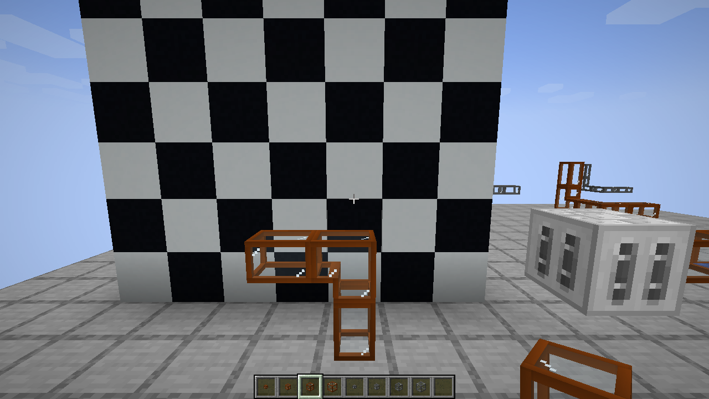
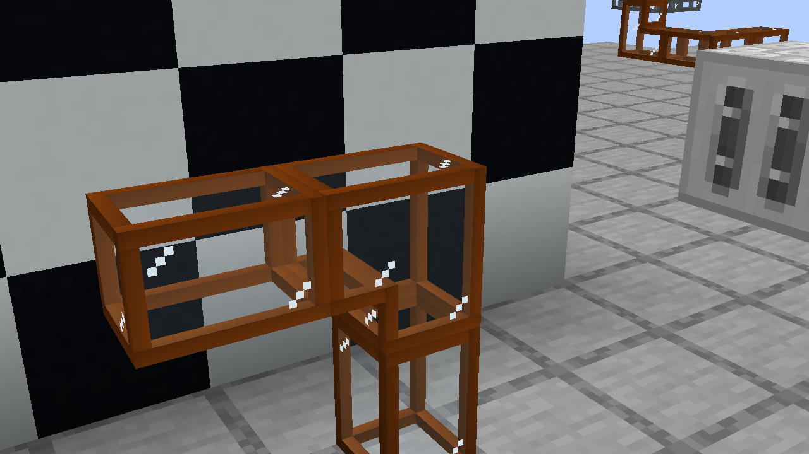
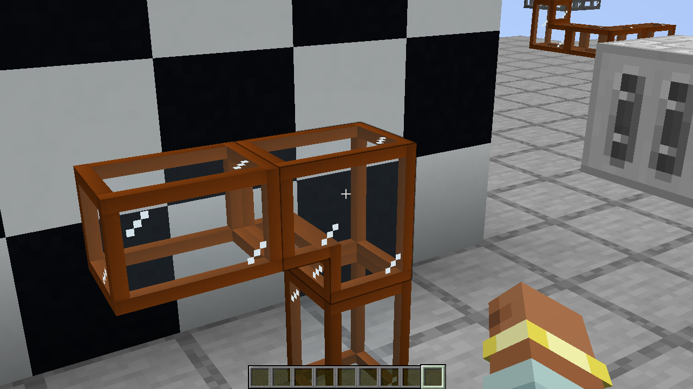

# Fluid-pipe frame and item fixes — 21.1.79

The glass tint and 32px highlight density from 21.1.78 are preserved.

## Problems and changes

The window mask checked only four neighboring cells. At a concave elbow it could
classify a corner of the metal border as glazing. The mask now includes diagonal
neighbors, retaining the complete one-pixel metal corner on every elbow orientation.

The previous model also rendered opaque metal and translucent glass in the same
translucent pass. The new composite model uses the solid pass for the frame and the
translucent pass for glazing. This lets the frame write depth before the visible
fluid is drawn.

The 3x3 highlight decal could also leave a darker rectangular patch on the pane.
Highlights now consist only of their three painted half-unit pixels, rendered as
opaque reflection details. They sample a uniform vanilla white texture, so transparent
decal pixels and their mip levels cannot draw a surrounding rectangle. Their overall
three-pixel diagonal shape and 32px density are retained.

Greedy meshing left some long edges meeting intermediate vertices of adjacent
faces. Structural faces now share a conforming grid: those edges are split at the
same coordinates. Metal UVs are interpolated from each original face, preserving
its appearance without restarting the texture on every subdivision. Glass retains
its position-derived UVs; highlights keep their original size.

The changes affect client rendering only. Pipe IDs, collision shape, recipes,
saved contents, pump covers, transfer rates and localization keys are unchanged.

A same-camera comparison also distinguishes Minecraft's normal black selection
outline from a texture gap. The outline disappears when the HUD/selection rendering
is hidden; it is not removed by this change.

## Inventory and held items

The pipe item-color callback returned only RGB, leaving its ARGB alpha at zero.
NeoForge's item renderer reads that alpha, making the tinted metal frame invisible
in the inventory and in the player's hand. The item callback now returns opaque
ARGB while preserving the original bronze/steel RGB values for all eight variants.
Block colors, model dimensions and glass transparency are unchanged by this fix.

A focused client pass checks the registered item-color callback for all eight pipe
variants, including opaque alpha and unchanged bronze/steel RGB. Native inventory
icons and bronze/steel first-person views are visually inspected; both frame and
glazing render passes are present.

## Validation

- The build passes **29 JUnit tests**. All 256 connection models retain complete
  elbow corner pixels and have no unmatched vertices along structural edges.
- Minecraft's model parser verifies separate solid/translucent parts, native glass
  UVs and individual reflection pixels without a surrounding decal quad.
- The final isolated client pass checks the actual baked render layers on all eight
  variants, real water/lava, synchronized flow and emptying. Close-up captures use
  a contrasting background and two viewpoints.
- A same-camera pair confirms that the normal selection outline disappears when
  selection rendering is hidden. The frame remains complete in both captures.
- No production client, ZIP or server files were changed. See the
  [validation receipt](validation/21.1.79.json).

