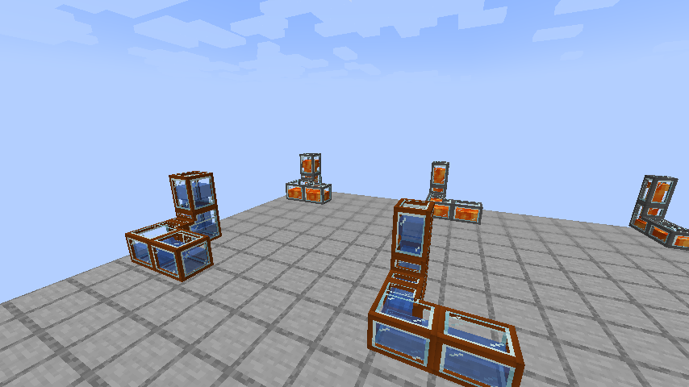
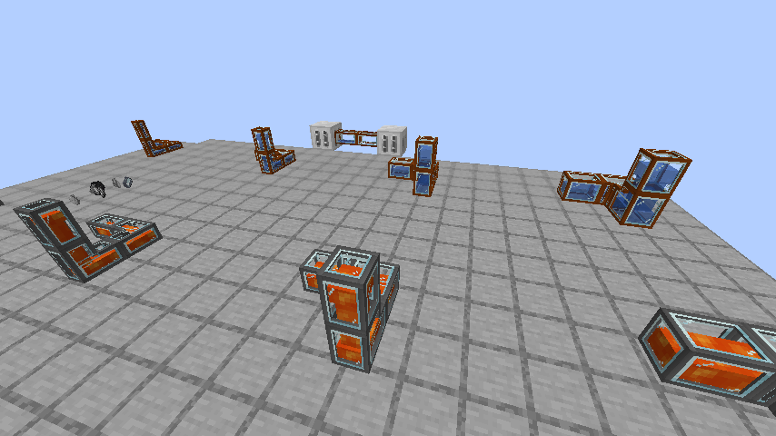

# Glass fluid pipes — 21.1.76

The previous restored pipe model placed its center and connected arms in the same
volume. Their coincident faces produced camera-dependent black stripes. Implicit
UV mapping also sampled a flat part of the original metal texture.

## Appearance

All eight bronze/steel pipes now use the selected thin-frame design with glass
windows. The shell is baked from the union of its connected sections, with disjoint
faces for all 64 connection states. Metal uses the existing 32x32 Experimental
texture and material tint; glass uses Minecraft's glass texture. No replacement
artwork or BuildCraft dependency is introduced.

Visible contents use the actual fluid sprite, tint, light emission and amount.
Horizontal channels show the fill level; vertical channels use a narrower column
at low fill. Negative-density fluids collect at the top. Five-tick updates carry
measured directional transfers, with interpolated levels and scrolling that stops
when transfer stops. Texture coordinates are split at atlas tile boundaries.

This separation of a static shell from dynamic fluid, including atlas-safe scrolling,
was informed by the [BCCE fluid renderer](https://github.com/BCCE-team/BuildCraft/blob/5a241786bb8e5cef466fb06bcd2ed1c690c8533e/source-platforms/neoforge/src/main/java/buildcraft/transport/client/render/PipeFlowRendererFluids.java).
The implementation uses IC2R's own tank, connection and transfer data.

## Recipes and behavior

Each existing recipe adds **one clear glass pane** in the center. Six metal casings
or plates and the original output counts are retained:

| Size | Metal | Output | Bronze capacity / rate | Steel capacity / rate |
| --- | --- | ---: | --- | --- |
| Tiny | 6 casings | 6 | 400 mB / 400 mB/s | 800 mB / 800 mB/s |
| Small | 6 casings | 3 | 800 mB / 800 mB/s | 1,600 mB / 1,600 mB/s |
| Medium | 6 plates | 2 | 2,400 mB / 2,400 mB/s | 4,800 mB / 4,800 mB/s |
| Large | 6 plates | 1 | 4,800 mB / 4,800 mB/s | 9,600 mB / 9,600 mB/s |

Pipes are passive. Place an LV/MV pump cover on the face toward the source to
extract up to 32/128 mB per tick, or use the source machine's fluid ejector.
Connecting a bare pipe to a Pump does not by itself extract the Pump's water.
The Ore Washing Plant accepts water through its native fluid capability.

Wrenches still disable individual connections. Closed neighboring ports no longer
draw a connected arm. Existing block/item IDs, saved tanks and covers are retained;
no player-facing text keys or translations change. BuildCraft and Addons are optional.

## Validation

- Build and **26 JUnit tests** pass, including every generated connection model's
  coplanar-face separation and all eight glass-pane recipes.
- **493 required standalone GameTests** pass. The added checks cover a native
  Pump feeding an Ore Washing Plant through an LV-covered pipe without fluid loss,
  interpolated levels, measured flow direction, stationary fluid and fluid replacement.
- One isolated client pass verifies all eight pipe variants with real water/lava,
  turns, vertical joins, emptying and measured flow arriving at the client. Four
  captured views were inspected, including opposite camera angles; the prior
  black-striping artifact was absent in those views.
- Existing localization coverage passes. No production client, ZIP or server
  files were changed by this source update.

See the [validation receipt](validation/21.1.76.json).
