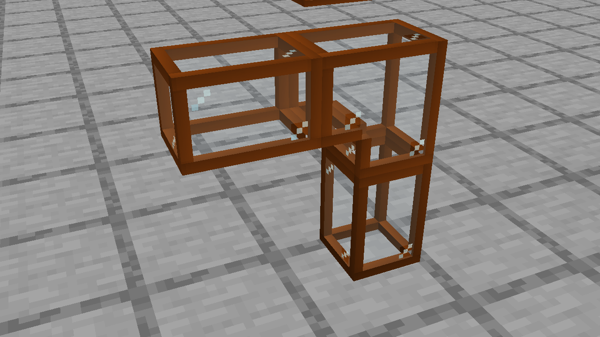
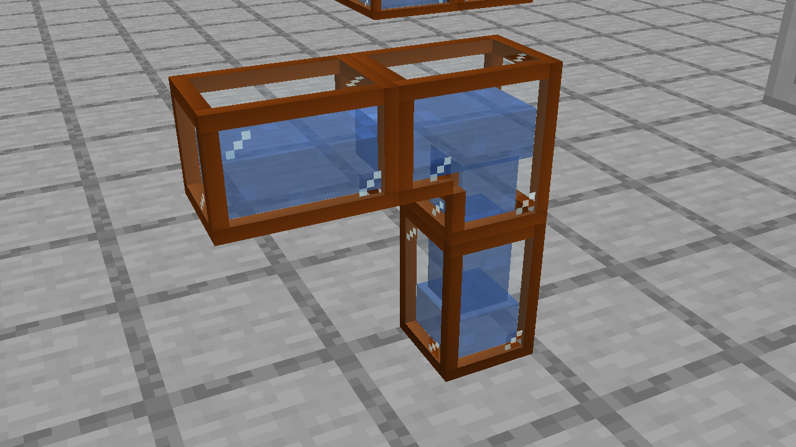

# Pipe glass UV preview

Status: unreleased, awaiting visual review. Stable `main` and installed clients remain
on 21.1.77 while this change is prepared on `fix/pipe-glass-uv`.

## Cause and change

The glass generator assigned a full 0..16 texture rectangle to every greedy-meshed
face, regardless of its dimensions. A long window stretched the square glass sprite;
a one-pixel patch at an elbow compressed the same sprite into a tiny framed insert.
That insert was glass, rather than an extra structural metal piece.

Glass uses Minecraft's position-derived UV mapping, so coplanar elbow patches share
the same texture coordinates. Sampling the center of vanilla clear glass, however,
made the first UV-corrected preview almost invisible.

The glazing now uses the vanilla white stained-glass surface with a subtle pale-blue
vertex tint and reduced alpha. It has one outward surface per wall and uses the
translucent render pass, avoiding stacked tint within the same thin wall. Small
three-pixel diagonal highlights come from the original vanilla clear-glass artwork.
They keep a fixed size at 32px density instead of stretching with each window.

The metal frame, disjoint shell geometry, texture assets, fluids, recipes, transfer
logic and saved IDs are unchanged. No raster assets or player-facing strings are added.

## Validation

- The build passes 27 JUnit tests. The new check parses all 256 connection models
  with Minecraft's actual model parser and verifies native UV coordinates and
  matching orientation on every glass patch. It also checks translucent rendering,
  non-opaque tint and fixed-size vanilla highlights.
- The existing coplanar-face checks still cover every size and connection state.
- An isolated development client displays all eight bronze/steel variants with
  actual water/lava and verifies synchronized fluid levels and emptying. Close
  views show the elbow both filled and empty.

These are development-client screenshots. This preview has not been installed in
the production client, exchange ZIP or server, and no version has been published.
