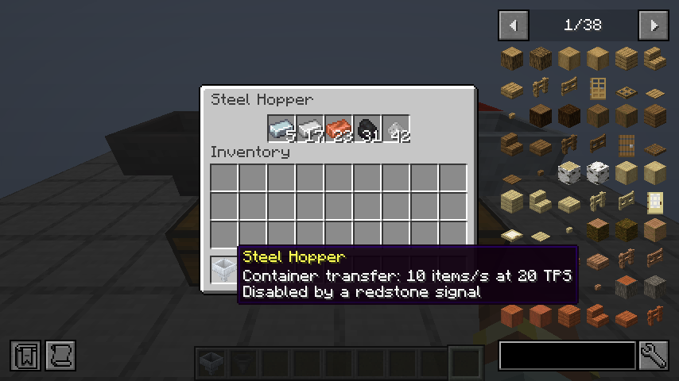

# Steel Hopper — IC2R 21.1.71

The fully heated Induction Furnace can smelt two items every 13 ticks, about
3.08 items/s at 20 TPS. A single vanilla hopper supplies 2.5 items/s, so the furnace
can exhaust its inputs. Steel hoppers provide faster external automation without
changing the furnace or the vanilla hopper.

## Crafting and transport

Craft one `ic2:steel_hopper` using this pattern:

```text
S S
SHS
 S
```

`S` is any ingot in `c:ingots/steel`; `H` is `minecraft:hopper`. The recipe consumes
five ingots and the hopper. It is available through the normal crafting recipe
type, recipe book and JEI. The item is in the IC2R Machines creative tab and uses
Uncommon rarity, giving it a yellow item name like the Induction Furnace.

The hopper moves one item per successful operation every two game ticks, up to
10 items/s at 20 TPS. Both pulling and pushing use vanilla hopper transfer logic.
A chain of steel hoppers retains this rate. Normal hoppers keep their own timing;
the throughput of a complete installation still depends on its other components.
No EU is consumed.

The implementation subclasses the vanilla hopper block and block entity. It retains
five inventory slots, down/horizontal placement, native GUI, comparator output,
loose-item collection, item drops, custom names, inventory saving and NeoForge item
capabilities. Successful-transfer cooldowns of 8/7 ticks become 2/1, preserving the
one-tick ordering adjustment between adjacent hoppers. Explicit custom cooldowns
are left intact. The block entity saves under its own `ic2:steel_hopper` ID.

Redstone disables the hopper's own pulling/pushing, as in vanilla. Other automation
can still access its inventory. The furnace's local warm-up button emits no signal
and does not lock this hopper. Mining requires a stone-tier or better pickaxe.

## Appearance and localization

Both block variants inherit vanilla hopper geometry. The item uses a separate 32x32
sprite with vanilla hopper item transforms, avoiding an oversized world model in hand.
The three opaque steel block textures are also native 32x32 assets; the vanilla
hopper textures are 16x16. Block dimensions and collision shapes are unchanged. English and Russian
translations cover the block/menu name, transfer-rate tooltip and redstone tooltip.



The approved concept, generated source atlas, exact generation prompt and reproducible
texture compiler are in [the texture sources](../tools/textures/steel_hopper/README.md).

## Validation

Five new GameTests cover measured transfer speed against a real vanilla hopper,
steel chains, native item capabilities and simulation, redstone locking,
save/reload, the native menu, drops, loose-item collection, crafting, rarity and
balanced loading of a fully heated Induction Furnace with retained smelting XP.
The resource test checks both model variants and native 32px texture detail.

The complete standalone suite passes: **24 JUnit tests and 484 GameTests**.
The opt-in client pass checks actual block rendering, the five-slot GUI, yellow
item names and both English/Russian translations in an isolated world.
Detailed artifact hashes and checks are recorded in [the validation report](validation/21.1.71.json).

This change is part of IC2R itself. IC2R Addons is neither required nor modified.
Existing client, ZIP and production-server installations are a separate update.
